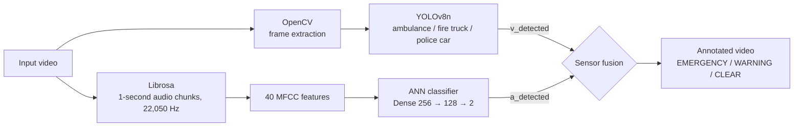

# 🚨 Emergency Vehicle Detection System — Made by Shashank

A minor project that detects emergency vehicles using both visual and audio signals at the same time. Instead of relying only on camera footage, it also listens for sirens and horns, then combines both to decide whether an emergency vehicle is actually present.

**Made by:** Shashank
**Live Demo:** [emergency-vehicle-detection.streamlit.app](https://emergency-vehicle-detection.streamlit.app)

---

## What it does

- Runs YOLOv8 on each video frame to spot ambulances, fire trucks, and police cars
- Extracts audio from the video using Librosa and classifies it (siren / horn) with a trained ANN
- Combines both results every second using simple logic:

```
visual + audio detected  →  EMERGENCY
visual only              →  WARNING: VISUAL ONLY
audio only               →  WARNING: SIREN ONLY
neither                  →  CLEAR
```

---

## Architecture



| Module | Model | Input | Output |
|--------|-------|-------|--------|
| Visual | YOLOv8n fine-tuned (50 epochs, 640×640) | Video frames | Bounding boxes → `v_detected` |
| Audio | 3-layer Dense ANN (UrbanSound8K) | 40 MFCCs per second | Siren vs horn → `a_detected` |
| Fusion | AND / OR rules | `v_detected`, `a_detected` | Status overlay on each frame |

---

## Project files

```
app.py                                   main Streamlit app
requirements.txt                         Python dependencies
packages.txt                             system packages for Streamlit Cloud
.streamlit/config.toml                   Streamlit theme & upload settings
2ndtimebest.pt                           YOLOv8 fine-tuned weights
siren_horn_detector.h5                   audio ANN weights
Output_Demo.mp4                          sample output video
training/yolov8_training.py              YOLOv8 training (Colab)
training/audio_model_training_and_fusion.py   audio ANN training + fusion demo (Colab)
```

---

## Run locally

```bash
git clone https://github.com/WR-Shashank/Emergency-vehicle-detection.git
cd Emergency-vehicle-detection
pip install -r requirements.txt
streamlit run app.py
```

## Deploy (Streamlit Community Cloud)

1. Go to [share.streamlit.io](https://share.streamlit.io) and sign in with GitHub
2. **Create app** → repo `WR-Shashank/Emergency-vehicle-detection`, branch `main`, file `app.py`
3. Set the app URL to `emergency-vehicle-detection` and pick Python 3.11 under *Advanced settings*
4. Click **Deploy**

## Retraining

The scripts in `training/` were exported from Google Colab. They read credentials from environment variables, so set these first:

```bash
export ROBOFLOW_API_KEY=...
export KAGGLE_USERNAME=...
export KAGGLE_KEY=...
```

---

## Stack

- YOLOv8 (Ultralytics) — object detection
- h5py + NumPy — audio model inference
- Librosa — MFCC feature extraction
- OpenCV — video frame processing
- Streamlit — web UI

## Datasets

- Visual model trained on: [Roboflow Emergency Vehicle Dataset](https://roboflow.com)
- Audio model trained on: [UrbanSound8K](https://urbansounddataset.weebly.com/urbansound8k.html)

---

Made by **Shashank**
